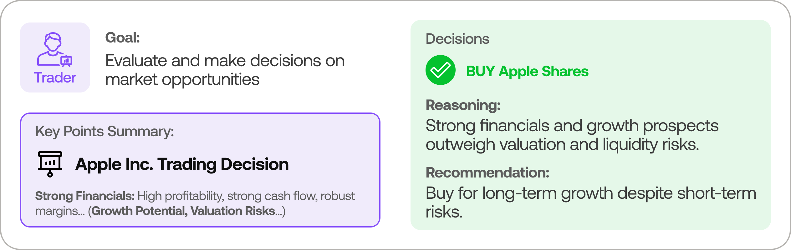

> **[中文化] TradingAgents**
>
> 此项目是 [TauricResearch/TradingAgents](https://github.com/TauricResearch/TradingAgents) 的中文翻译版本。
> - 原项目 Stars: 116882
> - 主语言: Python
> - 许可证: Apache-2.0
> - 翻译日期: 2026-10-27
> - 原始 README: [README_en.md](README_en.md)
>
> 说明：下方 README 正文为**原项目文档的中文翻译**，力求忠于原文；本页顶部的「中文快速上手」为**面向中文用户的补充导读**（非原文内容），目的是让你不用读完整篇 README 就能先把项目跑起来。
>
> 如有翻译不准确之处，欢迎提 Issue 或 PR。

---


## 🚀 中文快速上手（补充导读，非原文）

### 这是什么 / 解决什么问题

TradingAgents 是一个多智能体（multi-agent）金融交易框架，用多个由 LLM 驱动的专门角色（基本面分析师、情绪专家、技术分析师、交易员、风险管理团队等）协作评估市场状况并给出交易决策，这些智能体之间还会进行动态讨论以确定策略。它面向的是希望用大模型模拟真实交易公司分工、研究或实验交易决策流程的用户。项目采用 Apache-2.0 许可证，主语言为 Python。

### 快速上手（最短路径）

1. 确认 Python 版本 ≥ 3.11（见 `pyproject.toml` 的 `requires-python`）。
2. 在仓库根目录安装项目及其依赖（`requirements.txt` 说明其内容等同于 `pip install .`）：
   ```bash
   pip install .
   ```
3. 如需 Amazon Bedrock 支持，改用可选依赖安装：
   ```bash
   pip install "tradingagents[bedrock]"
   ```
4. 安装后会注册命令行入口 `tradingagents`（来自 `pyproject.toml` 的 `[project.scripts]`），运行：
   ```bash
   tradingagents
   ```
5. 也可使用 Docker：仓库根目录提供 `Dockerfile` 与 `docker-compose.yml`，镜像入口为 `tradingagents`。具体启动命令原文未提供明确命令，请参考下方 README 正文。

> 注：材料中 README 正文在「TradingAgents Framework」介绍后即截断，未包含完整的 Installation & CLI 章节，因此更细的安装/配置步骤原文未说明。

### 环境要求

- **操作系统**：原文未明确列出支持的系统；Dockerfile 基于 `python:3.13-slim`（Debian 系 Linux）。
- **Python 版本**：≥ 3.11（`pyproject.toml`）；Docker 镜像内使用 Python 3.13。
- **硬件**：原文未说明。
- **依赖**：核心依赖包括 `langchain-core`、`langchain-openai`、`langchain-anthropic`、`langchain-google-genai`、`langgraph`、`pandas`、`yfinance`、`typer`、`rich` 等（详见 `pyproject.toml`）；Bedrock 支持为可选依赖 `langchain-aws`。
- **其他**：需要配置 LLM 提供方的 API Key（材料提到 API-key auto-detection、`TRADINGAGENTS_*` 环境变量，但具体变量名原文未在给定片段中说明）。
- **国内网络提示**：依赖需从 PyPI 等源下载，国内用户可能需要更换镜像源或配置代理加速（材料提到项目支持 proxy，但具体配置原文未说明）。

### 常见坑与注意事项

- **需要 LLM API Key**：框架由 LLM 驱动，材料提到 API-key 自动检测与多提供方支持，使用前需准备好对应模型的密钥；具体配置方式原文未在给定片段中说明。
- **Python 版本门槛**：要求 Python ≥ 3.11，低于此版本无法安装。
- **Bedrock 需额外安装**：使用 Amazon Bedrock 必须安装 `tradingagents[bedrock]` 可选依赖，核心安装不含 `langchain-aws`。
- **README 片段不完整**：给定材料未包含完整的安装、CLI 参数与配置说明，遇到细节请以仓库 README 正文和 `CHANGELOG.md` 为准。

---


---

<p align="center">
  
</p>

<div align="center" style="line-height: 1;">
  <a href="https://arxiv.org/abs/2412.20138" target="_blank"></a>
  <a href="https://discord.com/invite/hk9PGKShPK" target="_blank"></a>
  <a href="https://x.com/TauricResearch" target="_blank"></a>
  <a href="https://github.com/TauricResearch/" target="_blank"></a>
</div>
<br>
<div align="center">
  <a href="https://github.com/TauricResearch" target="_blank"></a>
</div>
<br>
<div align="center">
  <!-- Keep these links. Translations will automatically update with the README. -->
  <a href="https://www.readme-i18n.com/TauricResearch/TradingAgents?lang=de">Deutsch</a> | 
  <a href="https://www.readme-i18n.com/TauricResearch/TradingAgents?lang=es">Español</a> | 
  <a href="https://www.readme-i18n.com/TauricResearch/TradingAgents?lang=fr">français</a> | 
  <a href="https://www.readme-i18n.com/TauricResearch/TradingAgents?lang=ja">日本語</a> | 
  <a href="https://www.readme-i18n.com/TauricResearch/TradingAgents?lang=ko">한국어</a> | 
  <a href="https://www.readme-i18n.com/TauricResearch/TradingAgents?lang=pt">Português</a> | 
  <a href="https://www.readme-i18n.com/TauricResearch/TradingAgents?lang=ru">Русский</a> | 
  <a href="https://www.readme-i18n.com/TauricResearch/TradingAgents?lang=zh">中文</a>
</div>

---

# TradingAgents：多智能体 LLM 金融交易框架

## 新闻

<!-- news:start -->
- [2026-10] **TradingAgents v0.7.1** 发布：决策仅按最终收盘价评分，并跨长假期结算；修复了模型日期可能读取运行日期之后提交的文件的问题；修复了投资组合、价格、SEC 报表和报告的问题。
- [2026-10] **TradingAgents v0.7.0** 发布：可在你自己的 ChatGPT Plus 或 Pro 套餐上运行；回测从每次决策后的首个收盘价开始评分；启动时提示有新版本；每个 GitHub 发布版本附带 wheel 包。
- [2026-10] **TradingAgents v0.6.0** 发布：报告保存为单个 HTML 页面；按模型层级配置提供商，使经理和分析师可运行在不同模型上；分析师工作期间结算每个股票代码的历史决策；Yahoo 新闻源故障期间从 Yahoo 搜索读取公司新闻。

完整发布说明见 [CHANGELOG.md](CHANGELOG.md)。

<details>
<summary>更早的新闻</summary>

- [2026-09] **TradingAgents v0.5.2** 发布：并行分析师加快分析速度；CLI 可通过 `--ticker`、`--date` 等标志无提示运行；每次运行的设置记录在每份报告中；回测只能看到各分析日期之前已发布的数据。
- [2026-09] **TradingAgents v0.5.1** 发布：包布局按各模块内容重新组织（导入路径已变更）；可选的 Jev 社交帖子筛查；默认模型为 GPT-6 Sol 和 Luna；修复了运行隔离和 SEC EDGAR 报表的问题。
- [2026-09] **TradingAgents v0.5.0** 发布：所有带日期的路径均实现时点完整性；SEC EDGAR 基本面数据按提交原样提供；支持在股票代码和日期网格上回测；支持感知投资组合的运行；所有提供商均采用当前模型阵容。
- [2026-08] **TradingAgents v0.4.0** 发布：修复了 FRED 宏观数据、社交情绪和决策日志记忆中的前视/时点问题；决策信号更清晰；CLI 检查点恢复可用；Trader 价格有据可依；新增 GPT-5.6 和 GLM-5.3 模型。
- [2026-07] **TradingAgents v0.3.1** 发布：正确性和稳定性修复：Alpha Vantage 前视过滤、图路由崩溃安全、感知图结构的检查点恢复、可用的加密情绪源、可配置的 LLM 重试预算、Bedrock API 密钥认证，以及 Claude Sonnet 5 / Fable 5 支持。
- [2026-06] **TradingAgents v0.3.0** 发布：经验证的数据访问契约；扩展的提供商注册表（NVIDIA、Kimi、Groq、Mistral、Bedrock 及任何 OpenAI 兼容端点）；FRED 和 Polymarket 数据供应商；当前代模型目录；CI 门禁。
- [2026-05] **TradingAgents v0.2.5** 发布：有据可依的情绪分析师；GPT-5.5 等模型覆盖；Qwen/GLM/MiniMax 双区域支持；`TRADINGAGENTS_*` 环境变量配置及 API 密钥自动检测；远程 Ollama 支持；非美国 alpha 基准；股票代码路径遍历加固。
- [2026-04] **TradingAgents v0.2.4** 发布：结构化输出智能体（研究经理、交易员、投资组合经理）；LangGraph 检查点恢复；持久决策日志；DeepSeek/Qwen/GLM/Azure 提供商支持；Docker；Windows UTF-8 编码修复。
- [2026-03] **TradingAgents v0.2.3** 发布：多语言支持；GPT-5.4 系列模型；统一模型目录；回测日期保真；代理支持。
- [2026-03] **TradingAgents v0.2.2** 发布：GPT-5.4/Gemini 3.1/Claude 4.6 模型覆盖；五级评级量表；OpenAI Responses API；Anthropic 努力度控制；跨平台稳定性。
- [2026-02] **TradingAgents v0.2.0** 发布：多提供商 LLM 支持（GPT-5.x、Gemini 3.x、Claude 4.x、Grok 4.x）及改进的系统架构。
- [2026-01] **Trading-R1** [技术报告](https://arxiv.org/abs/2509.11420) 发布，[Terminal](https://github.com/TauricResearch/Trading-R1) 预计很快推出。

</details>
<!-- news:end -->

<div align="center">

🚀 [TradingAgents](#tradingagents-framework) | ⚡ [安装与 CLI](#installation-and-cli) | 🎬 [演示](https://www.youtube.com/watch?v=90gr5lwjIho) | 📦 [包用法](#tradingagents-package) | 🤝 [贡献](#contributing) | 📄 [引用](#citation)

</div>

> 🎉 **TradingAgents** 正式发布！我们收到了大量关于这项工作的咨询，感谢社区的热情。
>
> 因此我们决定完全开源该框架。期待与你一起构建有影响力的项目！

## TradingAgents 框架

TradingAgents 是一个多智能体交易框架，模拟真实交易公司的运作方式。平台部署由 LLM 驱动的专业智能体：从基本面分析师、情绪专家、技术分析师，到交易员、风险管理团队，协同评估市场状况并指导交易决策。此外，这些智能体通过动态讨论确定最优策略。

<p align="center">
  
</p>

> TradingAgents 框架仅供研究使用。交易表现可能因多种因素而异，包括所选骨干语言模型、模型温度、交易时段、数据质量及其他非确定性因素。[它不构成财务、投资或交易建议。](https://tauric.ai/disclaimer/)

我们的框架将复杂交易任务分解为专业角色。

### 分析师团队
- 基本面分析师：评估公司财务和绩效指标，识别内在价值和潜在警示信号。
- 情绪分析师：汇总新闻标题、StockTwits 和 Reddit 讨论，形成单一情绪读数，以判断短期市场情绪。
- 新闻分析师：监控全球新闻和宏观经济指标，解读事件对市场状况的影响。
- 技术分析师：利用技术指标（如 MACD 和 RSI）识别交易形态并预测价格走势。

所选分析师同时工作，各自使用自己的工具；所有报告到齐后开始研究辩论。

<p align="center">
  
</p>

### 研究员团队
- 由看涨和看跌研究员组成，批判性评估分析师团队提供的见解。通过结构化辩论，在潜在收益与固有风险之间取得平衡。

<p align="center">
  
</p>

### 交易员智能体
- 综合分析师和研究员的报告做出明智的交易决策，确定交易时机和规模。

<p align="center">
  
</p>

### 风险管理和投资组合经理
- 通过评估市场波动性、流动性及其他风险因素，持续评估投资组合风险。风险管理团队评估并调整交易策略，向投资组合经理提供评估报告以供最终决策。
- 投资组合经理批准/拒绝交易提案。若批准，订单将发送至模拟交易所执行。

<p align="center">
  
</p>

## 安装与 CLI

### 安装

克隆 TradingAgents：
```bash
git clone https://github.com/TauricResearch/TradingAgents.git
cd TradingAgents
```

TradingAgents 需要 Python 3.11 或更高版本。在你喜欢的任何环境管理器中创建虚拟环境：
```bash
conda create -n tradingagents python=3.13
conda activate tradingagents
```

或使用 [uv](https://docs.astral.sh/uv/)：
```bash
uv venv --python 3.13
source .venv/bin/activate
```

安装包及其依赖（使用 uv 时为 `uv pip install .`）：
```bash
pip install .
```

### Docker

或者使用 Docker 运行：
```bash
cp .env.example .env  # 添加你的 API 密钥
docker compose run --rm tradingagents
```

更新仓库后，用 `docker compose build` 重新构建镜像。

结果、报告、记忆日志和缓存位于 `tradingagents_data` 卷中。若要将它们保存在主机文件夹中，请创建该文件夹并在 `.env` 或 shell 中将 `TRADINGAGENTS_DATA_DIR` 指向它：`mkdir -p data && TRADINGAGENTS_DATA_DIR=./data docker compose run --rm tradingagents`。

使用 Ollama 运行本地模型：
```bash
docker compose --profile ollama run --rm tradingagents-ollama
```

### 必需的 API

TradingAgents 支持多个 LLM 提供商。设置你所选提供商的 API 密钥：

```bash
export OPENAI_API_KEY=...          # OpenAI (GPT)
export GOOGLE_API_KEY=...          # Google (Gemini)
export ANTHROPIC_API_KEY=...       # Anthropic (Claude)
export XAI_API_KEY=...             # xAI (Grok)
export DEEPSEEK_API_KEY=...        # DeepSeek
export DASHSCOPE_API_KEY=...       # Qwen（国际，dashscope-intl.aliyuncs.com）
export DASHSCOPE_CN_API_KEY=...    # Qwen（中国，dashscope.aliyuncs.com）
export ZHIPU_API_KEY=...           # GLM 通过 Z.AI（国际）
export ZHIPU_CN_API_KEY=...        # GLM 通过 BigModel（中国，open.bigmodel.cn）
export MINIMAX_API_KEY=...         # MiniMax（全球，api.minimax.io）
export MINIMAX_CN_API_KEY=...      # MiniMax（中国，api.minimaxi.com）
export OPENROUTER_API_KEY=...      # OpenRouter
export MISTRAL_API_KEY=...         # Mistral
export MOONSHOT_API_KEY=...        # Kimi (Moonshot)
export GROQ_API_KEY=...            # Groq
export NVIDIA_API_KEY=...          # NVIDIA NIM
export FRED_API_KEY=...            # FRED 宏观数据（免费，可选）
export ALPHA_VANTAGE_API_KEY=...   # Alpha Vantage
export TYPESAFE_API_KEY=...        # Jev 社交帖子筛查（可选）
```

对于 Azure OpenAI，将 `.env.enterprise.example` 复制为 `.env.enterprise` 并填写凭据。使用 Docker 时，请将这些密钥放入 `.env`：镜像不包含 `.env` 文件。

若要使用 ChatGPT Plus 或 Pro 套餐而非 API 密钥运行，请在 CLI 的提供商菜单中选择"Subscription"，或设置 `llm_provider: "chatgpt"`。用 `tradingagents login chatgpt` 登录一次：它会打印一个地址供你在浏览器中打开，该地址会通过 `127.0.0.1` 返回本机。若浏览器运行在另一台机器上，或 TradingAgents 运行在 Docker 中（`docker compose run --rm tradingagents login chatgpt`），请粘贴浏览器最终跳转到的地址。登录信息保存在 `~/.tradingagents/chatgpt-auth.json`，`tradingagents logout chatgpt` 可撤销。运行会计入你套餐的使用限额，且套餐不接受 `temperature` 或 `max_tokens`。

对于 AWS Bedrock，用 `pip install ".[bedrock]"` 安装额外依赖，设置 `llm_provider: "bedrock"`，配置 AWS 凭据（环境变量、`~/.aws/credentials` 或 IAM 角色）和 `AWS_DEFAULT_REGION`，并使用 Bedrock 模型 ID，例如 `us.anthropic.claude-opus-5-5`。

对于本地模型，用 `llm_provider: "ollama"` 配置 Ollama。默认端点为 `http://localhost:11434/v1`；设置 `OLLAMA_BASE_URL` 指向远程 `ollama-serve`。用 `ollama pull <name>` 拉取模型，对于默认未列出的模型，在 CLI 中选择"Custom model ID"。

对于任何其他 OpenAI 兼容服务器（vLLM、LM Studio、llama.cpp 或自定义中继），使用 `llm_provider: "openai_compatible"` 并通过 `backend_url`（或 `TRADINGAGENTS_LLM_BACKEND_URL`）设置端点，例如 vLLM 用 `http://localhost:8000/v1`，LM Studio 用 `http://localhost:1234/v1`。模型即你的服务器所提供的模型。本地服务器无需密钥；端点需要时设置 `OPENAI_COMPATIBLE_API_KEY`。

设置 `TYPESAFE_API_KEY` 后，情绪分析师在阅读 StockTwits 和 Reddit 帖子前会用 TypeSafe 的 Jev 进行筛查。与公司无关的帖子会被丢弃，每个来源开头会列出剩余帖子按立场（看涨、看跌、中性或不明）的计数。未设置密钥时，帖子不经过筛查直接通过。`jev-latest` 随新版本变动；设置 `TYPESAFE_DEFAULT_MODEL` 为带版本的 ID（如 `jev-1.13.0`）可在多次运行间固定。若要通过 OpenRouter 访问 Jev，请将 OpenRouter 密钥放入 `TYPESAFE_API_KEY` 并设置 `TYPESAFE_BASE_URL=https://openrouter.ai/api`。

或者，将 `.env.example` 复制为 `.env` 并填写密钥：
```bash
cp .env.example .env
```

### CLI 用法

启动交互式 CLI：
```bash
tradingagents          # 已安装的命令
python -m cli.main     # 备选：直接从源码运行
```
你将看到可选择股票代码、分析日期、LLM 提供商、研究深度等的界面。上次运行的答案会作为默认值返回，按 Enter 即可接受。`.env` 中的 `TRADINGAGENTS_*` 变量仍会完全跳过对应步骤。

若要在无提问的情况下运行（用于定时任务或脚本），用标志回答每次运行的步骤，其余用 `TRADINGAGENTS_*` 变量：
```bash
export TRADINGAGENTS_LLM_PROVIDER=openai TRADINGAGENTS_QUICK_THINK_LLM=gpt-6-luna TRADINGAGENTS_DEEP_THINK_LLM=gpt-6-sol
export TRADINGAGENTS_OUTPUT_LANGUAGE=English TRADINGAGENTS_MAX_DEBATE_ROUNDS=1 TRADINGAGENTS_MAX_RISK_ROUNDS=1
tradingagents --ticker NV
```